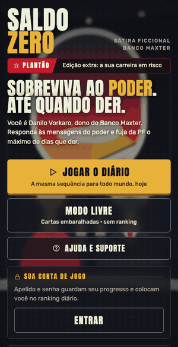

# Saldo Zero

**[▶ Play the demo in your browser](https://acsonbraz.github.io/saldo-zero/)** · [Português](README.md) · [Contributing](CONTRIBUTING.md)

<p align="center"></p>

**A satirical, fictional swipe-the-card decision game (Reigns-like) in Brazilian Portuguese.** You own a bank trying to survive power: read the messages, swipe each card left or right, keep cash, power, image and "radar" in balance, and avoid the police operation for as many days as you can. Mobile first, runs in the browser as a PWA (installable, works offline).

Open source, with player accounts, a daily leaderboard, an Asaas-powered store (Pix, card and boleto), a developer dashboard, support tickets and backups. Ready to put online.

  

> The game text is in Portuguese. Translating the cards to your language is a great first contribution (see [CONTRIBUTING](CONTRIBUTING.md)).

## Inspiration

The mechanic comes from **[Reigns](https://reigns-game.com/)** (Nerial and Devolver Digital): a character asks for a decision, you swipe the card to one side or the other, each choice moves a few gauges, and any gauge hitting 0 or 100 ends the run. Saldo Zero is an independent work: no code, art or text from Reigns, just that game idea (ideas are not protected). The story is an invented satire **inspired by news events**: characters, banks and institutions are fictional and any resemblance to real people is a coincidence.

## Use it however you like, commercially included

Free for **unrestricted commercial use**. You can:

- **completely change the context and story** (cards, characters, endings, name, art, branding);
- **define your own business model**: prices, subscriptions, store, ads, anything;
- **swap the payment provider**, host it anywhere and distribute your version.

The only condition is **attribution**: keep the copyright notice and the MIT license ([LICENSE](LICENSE)) and credit the original developer, **EBENIX Tecnologia** (EBENIX TECNOLOGIA INOVA SIMPLES (I.S.), Brazilian tax ID 68.730.443/0001-71), for example in a footer or "About" page: *"Based on Saldo Zero, by EBENIX Tecnologia."* You are responsible for the content and operation of your version (terms, privacy, taxes, applicable law). If you sell, the store notice must show **your** company name, tax ID and supplier address: edit `VENDOR` in `server.ts`, the `shopLegal` text in `game.html`, and the contact e-mail.

## Build your own game on this engine

The engine is generic: swap the story, keep accounts, leaderboard, store and PWA.

1. **Run it locally** (`bun run start`) and play a few runs.
2. **Replace the story** in `game.html`: characters in `CH`, cards in `CARDS` (text, the two answers, effects on the four gauges, and conditions to appear), endings in `ENDINGS`, items in `ITEMS`, achievements in `ACH`.
3. **Rebrand**: name, copy and colors ([`docs/DESIGN-SYSTEM.md`](docs/DESIGN-SYSTEM.md), in Portuguese), icons and preview image in `public/`, and the daily-challenge start date (`EPOCH`).
4. **Set your business** in `store.ts` (`PRODUCTS`), your payment provider, terms and privacy policy.
5. **Deploy** on any host that runs Bun with a volume for SQLite, and credit EBENIX Tecnologia as the license asks.

To just try it, `bun scripts/build-demo.ts` builds a **static demo** (`demo/`) that runs without a server, with simulated accounts and leaderboard in the browser.

## Run

Requires [Bun](https://bun.sh/).

```bash
bun run start        # http://localhost:3000
bun run test         # API tests (spins up a fake Asaas and the server)
```

Environment variables, endpoints and operations are documented in the [Portuguese README](README.md#execução-web). Tech: Bun + TypeScript, SQLite, a single-file front end (`game.html`), PWA.

## Status

Closed project by EBENIX Tecnologia: no active maintenance or support. It stays open for anyone to use and improve. MIT license with attribution. Work of fiction and satire.
