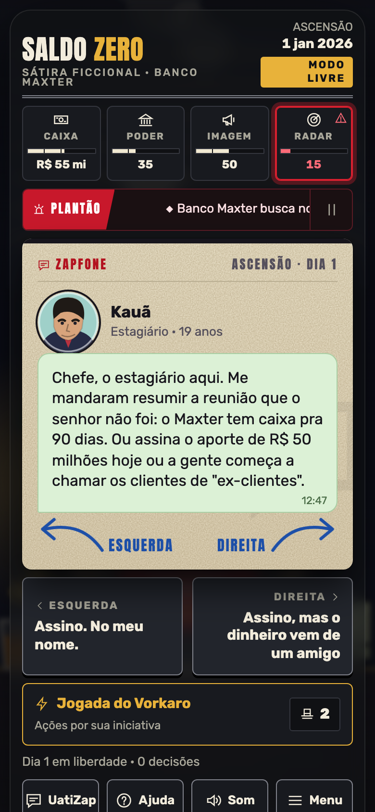
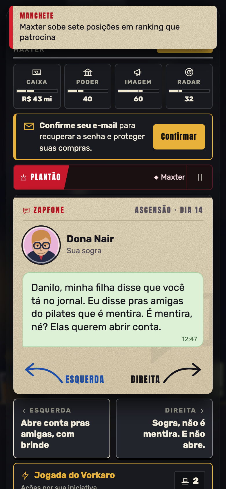
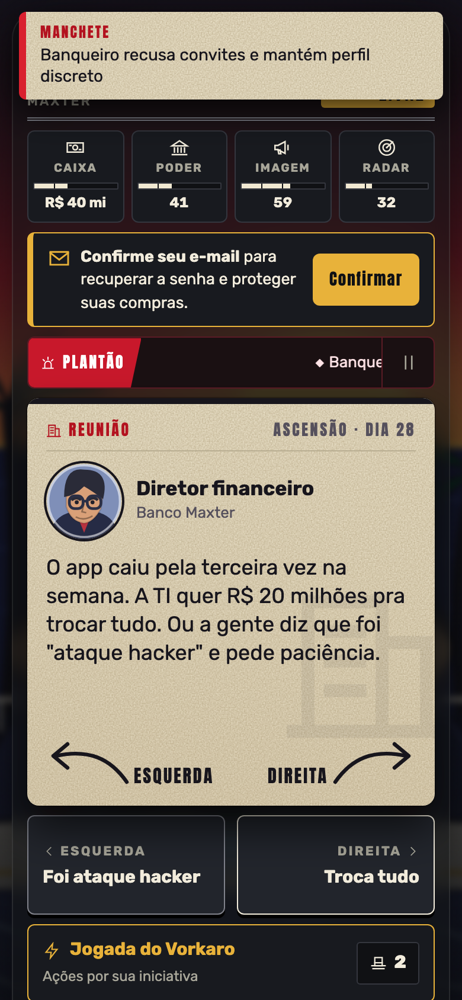

# Saldo Zero

**Jogo web de decisões, satírico e fictício, em estilo "arraste a carta".** Você é o dono de um banco tentando sobreviver ao poder: leia as mensagens, arraste cada cartão para a esquerda ou para a direita, segure caixa, poder, imagem e radar, e fuja da Operação Saldo Zero pelo maior número de dias. Mobile first, roda no navegador como PWA (instala na tela inicial e funciona sem internet).

Código aberto, com contas de jogador, ranking diário, loja integrada ao Asaas (Pix, cartão e boleto), painel do desenvolvedor, suporte e backup. Pronto para você pôr no ar.

| Início | Mensagem | Decisão | Reunião |
|---|---|---|---|
|  |  |  |  |

## Inspiração

A mecânica vem de **[Reigns](https://reigns-game.com/)** (Nerial e Devolver Digital): um personagem pede uma decisão, você arrasta o cartão para um lado ou para o outro, cada escolha mexe em indicadores e qualquer indicador em 0 ou 100 encerra a partida. O Saldo Zero é uma obra independente, sem código, arte nem texto do Reigns; só adota essa ideia de jogo, que não é protegida. A história é uma sátira inventada, **inspirada em fatos noticiados**: personagens, bancos e instituições são fictícios e qualquer semelhança com pessoas reais é coincidência.

## Use como quiser, inclusive comercialmente

Este projeto é livre para **uso comercial sem limitações**. Você pode:

- **mudar completamente o contexto e a história** (cartas, personagens, finais, nome, arte e identidade visual);
- **definir seu modelo de negócio**: preços, mensalidades, assinaturas, loja, anúncios, o que fizer sentido;
- **trocar o meio de pagamento**, hospedar onde quiser e distribuir sua versão.

A única condição é a **atribuição**: mantenha o aviso de copyright e a licença MIT (arquivo [LICENSE](LICENSE)) e credite o desenvolvedor original, **EBENIX Tecnologia** (EBENIX TECNOLOGIA INOVA SIMPLES (I.S.), CNPJ 68.730.443/0001-71), por exemplo em um rodapé ou na página "Sobre": *"Baseado no Saldo Zero, da EBENIX Tecnologia."* Você é responsável pelo conteúdo e pela operação da sua versão (termos, privacidade, tributos e a lei aplicável). Em especial, ao vender, o aviso da loja precisa trazer **o seu** nome empresarial, CNPJ e endereço de fornecedor (Decreto 7.962/2013): ajuste `VENDOR` em `server.ts` e o texto `shopLegal` em `game.html`, e troque o e-mail de contato (`contato@vorkaro.site`) pelo seu.

## Execução (web)

Requer [Bun](https://bun.sh/).

```bash
bun run start
```

O servidor monta a página em memória a partir de `game.html`, troca o Google Fonts pelas fontes locais, serve o PWA (manifesto, service worker, ícones), as páginas `/privacidade` e `/suporte` e a API (conta de jogo, loja, ranking). `./build.sh` gera um `index.html` standalone (não versionado) quando for preciso um arquivo estático.

### Variáveis de ambiente

| Variável | Para quê |
|---|---|
| `PORT` | porta (padrão 3000) |
| `SITE_URL` | domínio público, usado nas tags de preview e no retorno do pagamento (ex.: `https://vorkaro.site`) |
| `DATA_DIR` | pasta do banco SQLite (no Railway, o volume em `/data`) |
| `ASAAS_API_KEY` | chave da API do Asaas; sem ela a loja fica desligada |
| `ASAAS_ENV` | `sandbox` (padrão) ou `production` |
| `ASAAS_WEBHOOK_TOKEN` | token configurado no webhook do Asaas (header `asaas-access-token`) |
| `ADMIN_TOKEN` | senha do painel do desenvolvedor em `/admin` (mínimo 16 caracteres) |
| `RESEND_API_KEY` | chave do Resend para e-mails de confirmação e recuperação de senha; sem ela o código só vai para o log |
| `RESEND_FROM` | remetente em domínio verificado no Resend (padrão `Saldo Zero <contato@vorkaro.site>`) |
| `RESEND_REPLY_TO` | endereço que recebe respostas aos e-mails (padrão `contato@vorkaro.site`) |
| `DEV_CODES` | `1` apenas em testes: devolve o código na resposta da API. O servidor **recusa subir** com `DEV_CODES=1` e `ASAAS_ENV=production` |
| `TRUST_PROXY` | `1` para confiar em `X-Real-IP` fora do Railway (no Railway é automático via `RAILWAY_ENVIRONMENT`) |
| `GLOBAL_AUTH_PER_MIN` | limite global de tentativas de senha/código por minuto, somando todos os IPs (padrão 600) |
| `BACKUP_DISABLED` | `1` desliga o backup diário local |

### Conta de jogo, loja e ranking

- Conta (obrigatória para jogar no navegador): diálogo em etapas apelido -> senha -> e-mail opcional -> Jogar!. Senha nova ou trocada: 6 a 64 caracteres, com letras e números, sem espaço nas pontas, recusando senhas óbvias (abc123, senha123, repetições, o próprio apelido). Contas antigas com PIN numérico (4 a 8) continuam entrando: o login aceita qualquer texto de 4 a 64. O campo da API continua `pin` e a coluna `pin_hash` (argon2id). 5 erros seguidos bloqueiam a conta por 1 min, dobrando a cada erro (até 60 min), com o contador gravado no banco e reserva atômica da tentativa. Códigos de e-mail: aleatórios (`crypto.getRandomValues`), guardados como hash, 30 min de validade, até 5 envios e 10 erros por conta a cada 24 h. Sessões: só o hash SHA-256 do token fica no banco; expiram com 30 dias sem uso ou 90 dias desde o login; "Sair de todos os aparelhos" e "Excluir minha conta" (pede a senha; pedidos pagos ficam anonimizados por obrigação fiscal). Compras exigem e-mail confirmado; o ranking não. "Esqueci a senha" envia um código de troca.
- Abertura e áudio: `public/intro/intro.json` + SVGs (player em `public/js/intro-player.js`, toca na 1ª partida de cada conta e em Ajuda > Ver a intro; sem o JSON, o jogo começa direto) e `public/audio/*.mp3` (gerenciador Web Audio em `public/js/game-audio.js`: tema em loop na partida, sirene nas cartas de polícia, derrota ao ser preso; tudo segue o botão Som e só começa após um gesto). O service worker guarda `/audio/` e `/intro/` em runtime, não na instalação. Testes visuais: `node scripts/shots-login.cjs` (mesmo servidor do e2e).
- VIP para sempre (`com.saldozero.vip`, R$ 19,90, de R$ 59,90): 15 favores por partida, baralho eleitoral, escolha de capa e destaque no ranking. A loja mostra o preço riscado, o desconto e um cronômetro de 15 minutos em loop.
- Favores: moeda das jogadas do Vorkaro e dos recursos no modo livre. Toda partida começa com 2; pacotes de 10 e 30 ficam na conta.
- Loja (Asaas, checkout hospedado com Pix, cartão e boleto): `POST /api/checkout` cria a cobrança, o jogador paga na página do Asaas e volta para `SITE_URL/?pedido=<ref>`; `GET /api/order/:id` (só o dono; responde pelo banco e consulta o Asaas se pendente há mais de 30 s); `POST /api/webhook/asaas` confere o token em tempo constante, reconsulta a cobrança no Asaas e sempre responde 200 depois do token. Estorno/chargeback revoga o item; favores de pacote estornado são descontados e o saldo pode ficar negativo (o servidor não deixa gastar sem saldo). Um pagamento libera produto para uma única conta (`entitlements.payment_id` único). `POST /api/restore` exige login e só liga pedidos do próprio usuário ou sem dono cujo CPF/CNPJ bate com o da cobrança. Os itens valem a partir de `/api/me`; o localStorage é só cache.
- Ranking diário: o dia é o de Brasília (America/Sao_Paulo), calculado no servidor; `POST /api/daily` aceita só o dia corrente (10 min de tolerância após a meia-noite) e recusa resultados impossíveis para o motor (5 a 27 dias por decisão, no máximo 760 dias, "lenda" só a partir do dia 730); `GET /api/daily?day=` lista o top 50. No diário todo mundo tem 2 favores (inclusive VIP) e, ao retomar uma partida, o estado do gerador é restaurado: mesmas cartas para todos.
- Ajuda e suporte: menu Ajuda no jogo (como jogar, indicadores, favores, compras) com formulário de chamado (`POST /api/support`); o jogador vê a resposta no mesmo menu.
- Painel do desenvolvedor em `/admin` (token em `ADMIN_TOKEN`): receita total, do mês e do dia, vendas por produto, lista de cobranças, usuários (bloquear, excluir, dar ou tirar favores, dar ou remover produtos, trocar PIN, renomear, anotação) e chamados com resposta.
- Balanceamento: três decisões seguidas puxando o mesmo indicador (obsessão) encolhem o ganho e dobram os efeitos colaterais; indicador acima de 70 aquece o radar a cada turno e acima de 80 drena outro; acima de 75 cada ponto ganho vale metade (90: um terço); jogadas do Vorkaro repetidas rendem menos e custam mais. Ocorrências (`oc:true` no baralho) aparecem em ~20% dos turnos a partir do 3º, com opções cujo resultado é uma função do estado (`(s,rng)=>[fx,meta]`).
- Segurança HTTP: CSP só com `'self'` e o hash dos scripts inline (calculado no boot; atributos `onclick="..."` não funcionam), HSTS, `nosniff`, `Referrer-Policy`, `frame-ancestors 'none'`. IP do cliente: no Railway vem de `X-Real-IP` (gravado pela borda); na falta, o último item de `X-Forwarded-For`.
- Operação: `bun server.ts` direto; `GET /health` testa o banco; SIGTERM fecha o banco; backup diário com `VACUUM INTO` em `DATA_DIR/backups` (7 arquivos). Backup externo (bucket) não implementado; aprovação de gasto: o backup local não protege contra perda do volume.
- Testes: `bun run test` (`scripts/test-api.ts`, asserts de API: sobe Asaas falso e servidor sozinho); `scripts/fake-asaas.ts` imita o Asaas, com webhook e estorno; `scripts/e2e.cjs` percorre conta, compra, itens vindos do servidor, ranking, retomada e exclusão no navegador (Playwright, asserts); `scripts/balance.cjs` simula estratégias (só imagem, só poder, cuidadoso, aleatório) no motor real e mostra a distribuição de finais.

## Arquivos

- `game.html` — todo o jogo (estilos, baralho, mecânicas, telas, ponte com o app nativo).
- `server.ts` — servidor Bun.
- `store.ts`, `auth.ts`, `admin.ts`, `db.ts` — loja (Asaas), conta de jogo e suporte, painel do desenvolvedor, banco SQLite.
- `admin.html` — painel do desenvolvedor (servido em `/admin`).
- `scripts/sim.cjs` — joga dezenas de partidas aleatórias em Chromium headless e imprime a distribuição de finais e erros de console.
- `public/` — manifesto do PWA, service worker, ícones, imagem de preview (`og.png`) e fontes.
- App iOS (xtool + StoreKit) guardado na branch `claude/ios-app`, caso a distribuição em loja volte à pauta.

## Hospedagem

O jogo roda em qualquer host que execute Bun com um volume para o SQLite (`DATA_DIR`). O deploy original usava Railway com deploy automático da branch `main`; não há infraestrutura ativa mantida por este repositório.

## Nomes

- App e marca: **Saldo Zero**.
- Banco do jogo: **Banco Maxter**. Protagonista: Danilo Vorkaro.
- Obra de ficção e sátira: personagens, bancos, veículos e instituições são inventados.

## Status e aviso

Projeto encerrado pela EBENIX Tecnologia: sem manutenção ativa nem suporte; fica aberto para quem quiser usar e evoluir. Licença MIT, com atribuição (ver acima). Obra de ficção e sátira; personagens, bancos, veículos e instituições são inventados e qualquer semelhança com pessoas ou fatos reais é coincidência.
